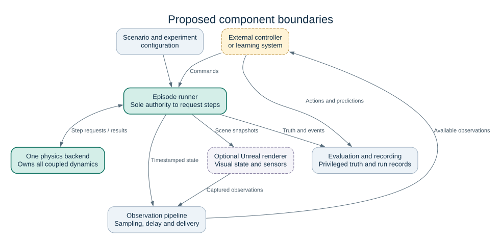
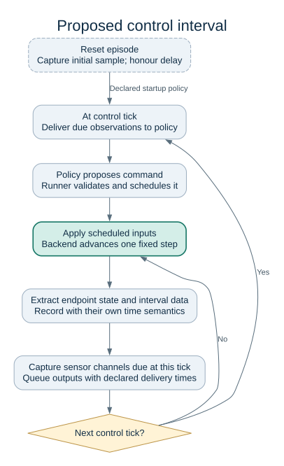

# Architecture

> **Status: proposed design.** This document describes the intended boundaries of
> BRICS. It does not imply that these components, interfaces or integrations are
> implemented. The first planned simulation example is small, headless and based
> on MuJoCo; the current setup establishes the development environment.
> Architectural decisions remain subject to team review through the ADRs.

## Design objective

BRICS should support reusable construction robotics simulation, beginning with
suspended-load manipulation. The platform supplies physical models, scenario execution,
observations and measurements for different controllers and learning systems.

The design should let a researcher change a payload, suspension configuration,
controller or evaluation method without rewriting the experiment. Backend
independence is useful where it protects those experiments. It does not mean that
every physical model can run unchanged in every simulator, or that equivalent
parameter names produce equivalent dynamics.

Python is the proposed application language. MuJoCo provides the first dynamics
implementation. Unreal Engine 5 is a proposed optional renderer, and ROS 2 is a
possible optional integration. Neither is required for the first physics task.

## Component boundaries



[Open full-size diagram](assets/architecture-components.svg).

| Component | Owns | Must not own |
| --- | --- | --- |
| Scenario definition | Initial conditions, asset references, randomisation ranges, named entities and task requirements | Solver stepping or policy decisions |
| Episode runner | Reset, command scheduling, advancement requests, termination and simulation-time coordination | Backend-specific contact equations |
| Physics adapter | Native model construction/loading, dynamics execution and extraction of supported physical quantities | Experiment-level success criteria |
| Observation pipeline | Sampling, coordinate conversion, noise, delay, dropout and delivery | Undeclared access to future or privileged state |
| External policy/controller | Decisions based on its declared observations and action interface | Direct mutation or stepping of the physics backend |
| Renderer adapter | Visual scene updates and declared camera/sensor outputs | Authoritative dynamics or contact response |
| Evaluator/recorder | Metrics, privileged reference data, event records and experiment metadata | Changing the policy's observations without an explicit experiment setting |

These are responsibilities, not a requirement to create seven packages or a
plugin framework immediately. A few well-separated functions are sufficient for
the first example. Extract an interface when two concrete uses demonstrate what
must be shared.

## Platform and application boundary

A policy, world model or external robotics controller is a consumer of BRICS.
It receives declared observations and submits commands. Its training,
prediction architecture, optimisation and study-specific evaluation remain
outside the platform core. Example controllers may demonstrate the interface
without making their implementation a runtime dependency.

BRICS supplies the physical measurements and task outcomes that applications
can use. Research code should import a pinned release or recorded commit of
BRICS; BRICS must not import research code. Share capabilities upstream when
they acquire a reusable contract, tests, documentation and a maintenance owner.
Benchmark-specific configuration belongs with a versioned scenario or suite,
rather than being hard-coded into the simulation runner.

## Bounded backend independence

Separate three kinds of information:

1. **Experiment intent:** task, initial conditions, seeds, observation channels,
   action limits, termination conditions and evaluation definitions.
2. **Physical intent:** dimensions, mass, inertia, attachment locations, materials,
   collision surfaces, suspension topology and actuator capabilities.
3. **Backend realisation:** native model files, solver settings, contact laws,
   numerical regularisation and approximations used to represent the intent.

The first two should remain understandable without importing an engine's Python
objects. The third remains explicitly backend-specific.

An eventual adapter should expose only capabilities needed by implemented
experiments: loading, resetting, applying named commands, advancing a specified
number of steps and reading supported state/events. Return plain data with
documented units and frames. Do not leak native object handles into policies or
evaluation code.

Named robot parts and attachment frames make scenarios readable, but the native
backend model must still define how a joint, tendon or cable behaves. URDF can
describe useful robot structure; it is not the complete representation of the
planned suspension, contact, sensing and experiment semantics. MuJoCo's own
[modeling documentation](https://mujoco.readthedocs.io/en/stable/modeling.html)
explains the differences between its MJCF representation and URDF support.

Backend interchangeability must be demonstrated with an explicit supported
subset and conformance checks. It does not imply interchangeable trained
policies, identical contact forces, or numerical equivalence across engines.

## Coordinates and assets

Propose SI units and a right-handed world frame with positive z upward for the
BRICS-facing data contract. Specify each robot, attachment and sensor frame;
do not assume its axes match the world frame. A field should identify its unit
and frame, and pose documentation must state transform direction and quaternion
ordering. For a first shared pose representation, use scalar-first `w, x, y, z`
and a local-to-world rotation; validate adapters against known transforms before
making that representation a public contract.

Mass properties need a centre of mass and an inertia tensor about a stated
point, expressed in a stated frame. A visual mesh is not evidence of material
density or mass. Do not infer authoritative physical properties from imported
BIM or point-cloud geometry without a documented estimation process.

Keep source assets, collision geometry and render geometry distinguishable.
Record their source, licence, revision or content hash, scale, origin,
transformations and intended use. Attach stable entity names to the physical
and visual representations so that a rendered object can be traced to its
physics state. Unit, handedness and camera-axis conversions belong in adapters,
with round-trip and known-pose checks.

Backend-native model files remain the initial executable description. Rich BIM,
point-cloud and generic robot import pipelines are deferred. A simple native
model with known dimensions is preferable to an imported model with unknown
collision, inertia or coordinate semantics.

## One owner of dynamics

For the initial architecture, **one backend owns all mechanically interacting
entities in a world for the entire episode**. This includes the robot, suspension,
payload, guides and receiving structure. Static fixtures also belong to that
backend's collision world.

A controller or wind model may calculate forces that the backend applies. This
does not create a second dynamics authority. Different physical representations
inside one engine are acceptable when that engine supports their coupling.

The following are unsupported:

- A cable in one engine pulling a payload whose contacts are solved by another.
- Switching the payload between engines when it touches a guide or lands.
- Enabling Unreal's rigid-body physics on the load or its interacting fixtures.
- Calling the backend's step function from rendering, policy or middleware code.

Independent worlds may use different backends in separate experiments. Coupling
engines within one mechanical system requires an explicit numerical coupling
method, state-transfer rules and validation of energy and momentum behaviour.
It is outside the initial project scope.

### Attachment and release events

A real latch, hook or twistlock can eventually be represented by a discrete
state change within the owning backend. Define engagement conditions, alignment,
command authority, timing and release rules. Record the event and any constraint
creation or removal so its effects can be tested and replayed.

An insertion pin touching a socket is not automatically a latch. Preserve the
physical contacts that can produce rim strikes, sliding, wedging and rebound;
do not make placement succeed by snapping the payload into a constraint. If a
backend cannot support a required attachment transition with defined semantics,
reject that scenario. Changing the constraint graph does not permit changing
physics engines midway through an episode.

## Time, commands and observations

The episode runner is the only component authorised to request physics
advancement. The backend advances with a fixed configured physics timestep and
reports completed simulation time. A slow renderer or host machine changes wall
time; it must not silently change simulated time or introduce sensor latency.

Physics, controller and sensor rates are distinct. Initially prefer control and
sensor periods that are integer multiples of the physics timestep, and document
the scheduling order.
Use a step index as well as simulation timestamps. Check returned backend time
against the expected timeline rather than allowing independent clocks to drift.



[Open full-size diagram](assets/architecture-timing.svg).

The diagram is a proposed logical order, not a frozen API. At reset, capture the
initial observation and apply the configured delivery delay. Define how the
controller behaves before its first valid observation: for example, a declared
hold command or a separately recorded warm-up. Do not silently bypass delay at
startup. At a tick shared by several
activities, define capture, delivery and control ordering explicitly. A policy
must not consume an observation before its configured delivery time.

Every sensor sample needs at least an episode identity, channel identity,
simulation capture time and delivery time. If a sample becomes available between
control ticks, distinguish its availability from the time the policy consumes it.
Record frame/sequence identifiers
where needed. Delay and dropout are deliberate experiment settings. Record the
commands actually applied after clipping, rate limits and delay, as well as
requested commands when useful.

Renderer-generated observations must identify the physics state they depict. If
RGB images are required for the next action, the runner needs a completion
barrier or another explicit observation-delivery rule. A wall-clock screenshot
of whichever frame happens to be visible is not sufficient.

Contact evaluation uses physics-step data, not only controller-rate samples.
Record pre/post-event state and supported contact quantities with their precise
semantics. An endpoint pose and solver contact data returned by the same stepping
call need not describe the same instant. Each field must identify whether it
describes the interval just integrated, an internal evaluation time or the
endpoint state; do not relabel all fields with the endpoint timestamp. Backend
force estimates, impulses, contact identifiers and peak loads
are not automatically comparable; see [validation and limitations](validation.md).

## Reset and reproducibility

A reset must clear more than body poses. It must reset relevant actuator and
solver state, command queues, sensor histories, delayed observations, controller
memory, model recurrent state and scheduled events. Start a new episode identity
so late messages from the previous episode can be rejected.

Record configuration, backend and package versions, model/asset identifiers,
random seeds, solver settings, timestep and relevant platform information. Define
repeatability using stated tolerances; a fixed seed alone is not a promise of
bitwise equality across hardware or backend versions.

Distinguish three uses of recorded data:

- **Visual replay:** rendering recorded states without rerunning dynamics.
- **Experiment rerun:** resetting and executing the recorded configuration and
  applied commands again.
- **Checkpoint continuation:** restoring enough hidden state to continue exactly.

The first does not establish the second, and neither establishes complete
checkpoint support. Checkpoints are deferred until a concrete research need
justifies their backend-specific requirements.

## Unreal Engine integration

Begin with pose replay to check axes, units, object identities, camera calibration
and frame timestamps. Add synchronous camera observations only when the research
requires them. Keep collision geometry and visual geometry separate, with a
documented transformation between them.

Unreal receives authoritative transforms; it does not generate a second contact
response. Interpolation for a demonstration video must not silently become the
state used for research observations. Wire appearance and visibility settings
must be documented when generating perception data.

Python supports Unreal editor automation, but its standard Python plugin is
[not a gameplay runtime](https://dev.epicgames.com/documentation/en-us/unreal-engine/scripting-the-unreal-editor-using-python).
A runtime bridge will therefore need an appropriate Unreal implementation, such
as a small C++ plugin with Blueprint-facing configuration. This bridge is planned,
not an existing BRICS feature.

## ROS 2 and other integrations

The core experiment should run through direct Python calls. A future ROS 2 bridge
can translate commands and observations, publish transforms and simulated time,
and expose reset/episode information. ROS callbacks enqueue requests; they never
advance physics themselves.

ROS 2's [`/clock` and `use_sim_time`](https://design.ros2.org/articles/clock_and_time.html)
support a shared simulation-time reference. They do not establish a barrier
ensuring that every controller has finished a step. A synchronous experiment
needs an explicit scheduler or acknowledgement protocol, plus policies for stale,
late and missing commands. Middleware delivery timing must be distinguished from
intentional simulated delay.

Other integrations should use the same command and observation meanings rather
than making their message formats the core representation. There is no need to
implement multiple transports before one is required.

## Capability checks and failure policy

Reject a scenario before running when it requests an unsupported required
capability, has invalid physical parameters or undefined frames, assigns duplicate
physics ownership, or selects an unsupported actuator mode. An adapter must not
silently discard a suspension feature or replace a required sensor.

An approximation is acceptable only when explicitly selected, documented and
recorded with the run: for example, a segmented suspension representation or
simplified collision mesh. Warn when a selected approximation affects an
experiment's interpretation. Numerical divergence, non-finite state or missing
required output must produce an invalid-run outcome, not a successful episode.

## Implementation limits

The initial system does not promise a universal scene format, live backend
switching, mixed-engine dynamics, distributed execution, exact checkpointing,
photorealistic headless training, full ROS integration or real-world safety.
Physical fidelity and sensor realism must be assessed for the specific
experiments in which they are used.

Implement the smallest vertical example first. Add architecture only when the
next experiment needs it, while preserving the ownership and data boundaries
above.


## Editing the diagrams

The diagrams are committed SVG files so they render in GitHub and standard
MkDocs without JavaScript plugins or external services. Their editable source
is [architecture-components.dot](assets/architecture-components.dot) and
[architecture-timing.dot](assets/architecture-timing.dot).

Only diagram authors need Graphviz. After editing a source, regenerate its SVG
from the repository root:

```bash
dot -Tsvg docs/assets/architecture-components.dot -o docs/assets/architecture-components.svg
dot -Tsvg docs/assets/architecture-timing.dot -o docs/assets/architecture-timing.svg
```

Inspect the images and commit source and SVG together. Building or reading the
site does not require Graphviz.
